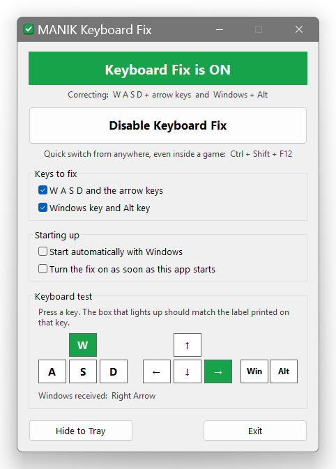
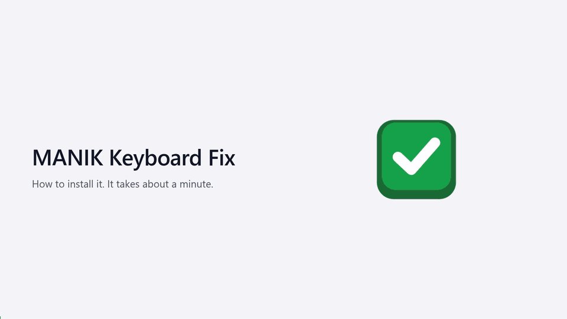

# MANIK Keyboard Fix

A small Windows 11 utility that corrects a MANIK gaming keyboard whose onboard configuration has
swapped **W A S D with the arrow keys** and **Left Windows with Left Alt**.

The fault lives in the keyboard, so it follows the keyboard to every computer. This app undoes it in
software while it is running, and changes nothing permanently. Turn it off, or close it, and the
keyboard behaves exactly as it did before.

This is an unofficial fix. It is not made by, or affiliated with, the keyboard's manufacturer.



## Download

**[Download the installer: MANIK-Keyboard-Fix.msi](https://github.com/atwellpub/manik-keyboard-fix/releases/latest/download/MANIK-Keyboard-Fix.msi)**

That link always fetches the newest version. The
[latest release](https://github.com/atwellpub/manik-keyboard-fix/releases/latest) page also has the
standalone exe and the install video.

New to it? Watch the one-minute install walkthrough: it plays [further down this page](#install),
and you can download it as a video,
[install-guide.mp4](https://github.com/atwellpub/manik-keyboard-fix/releases/latest/download/install-guide.mp4).

## What it corrects

| The keyboard sends | The app turns it into |
|---|---|
| W | Up Arrow |
| A | Left Arrow |
| S | Down Arrow |
| D | Right Arrow |
| Up Arrow | W |
| Left Arrow | A |
| Down Arrow | S |
| Right Arrow | D |
| Left Windows | Left Alt |
| Left Alt | Left Windows |

With the fix on, every key does what is printed on it. Held keys, key repeat, several keys at once,
and combinations with Shift, Ctrl and Alt all carry through.

## Install



The same walkthrough as a video file, for sharing:
[install-guide.mp4](https://github.com/atwellpub/manik-keyboard-fix/releases/latest/download/install-guide.mp4).

There are two ways to get it onto a PC. Both end up running the same program.

### Option 1: the installer (recommended)

1. [Download `MANIK-Keyboard-Fix.msi`](https://github.com/atwellpub/manik-keyboard-fix/releases/latest/download/MANIK-Keyboard-Fix.msi)
   onto the PC and double-click it.
2. A short progress bar appears, then the app opens by itself.

The installer puts the app in your own user profile, so it **does not ask for an administrator
password** and works on a child account. It adds a shortcut to the Desktop and to the Start menu,
and an entry under **Settings > Apps > Installed apps**.

Install it while signed in as the person who will use the keyboard. It installs for that Windows
account only.

### Option 2: the standalone exe

[Download `MANIK-Keyboard-Fix.exe`](https://github.com/atwellpub/manik-keyboard-fix/releases/latest/download/MANIK-Keyboard-Fix.exe),
put it anywhere (the Desktop is fine) and double-click it. There is nothing to install and nothing
else is needed.

### If Windows shows a blue "Windows protected your PC" box

The files are not code-signed, so Microsoft SmartScreen may warn the first time a downloaded copy is
opened. Choose **More info**, then **Run anyway**. Copies moved over on a USB stick usually open
without the warning.

## Using it

Open **MANIK Keyboard Fix**. The window has everything on one page:

| Part of the window | What it does |
|---|---|
| Status banner | **Green** and "Keyboard Fix is ON" while keys are being corrected. **Gray** and "Keyboard Fix is OFF" when the keyboard is untouched. |
| Enable / Disable Keyboard Fix | The big button. Turns all corrections on or off. |
| Keys to fix | Two ticks: one for W A S D and the arrow keys, one for the Windows and Alt keys. Untick one to leave those keys alone. |
| Start automatically with Windows | Starts the app, hidden in the tray, each time you sign in. |
| Turn the fix on as soon as this app starts | Starts with the corrections already on. |
| Keyboard test | Press a key and the matching box lights up. With the fix on, the box that lights should match the label printed on the key you pressed. |
| Hide to Tray | Hides the window. The app keeps running. |
| Exit | Closes the app completely and returns the keyboard to how it was. |

### The quickest setup for a child

Do this once:

1. Tick **Start automatically with Windows**.
2. Tick **Turn the fix on as soon as this app starts**.
3. Click **Enable Keyboard Fix**, then **Hide to Tray**.

From then on the keyboard is corrected every time the PC is switched on, with nothing to click.

### The system tray

Minimizing the window, or closing it with the X, hides it to the system tray (the row of small icons
by the clock). It does **not** switch the fix off. Only **Exit** closes the app.

The tray icon is a keycap: **green with a tick** while the fix is on, **gray with a bar** while it is
off. Click it to open the window. Right-click it for:

- **Enable Keyboard Fix** or **Disable Keyboard Fix**
- **Open Settings**
- **Exit**

Windows 11 tucks new tray icons behind the small **^** arrow. To keep this one in view, open the
arrow and drag the keycap down onto the taskbar.

### The emergency switch: Ctrl + Shift + F12

**Ctrl + Shift + F12** turns all corrections on or off from anywhere, including inside a game. It
works whether the fix is currently on or off.

Because there is no window to look at inside a game, it answers with a sound: two rising notes for
**on**, two falling notes for **off**.

## Troubleshooting

**"This installation package could not be opened."** The MSI is being opened from a network drive
or a WSL folder (a path such as `X:\...` or `\\wsl.localhost\...`). Windows Installer cannot read a
package from there. Copy the file to the Desktop or the Downloads folder and double-click that copy,
or download it again from the [latest release](https://github.com/atwellpub/manik-keyboard-fix/releases/latest).

**The keys are still wrong.** Open the window and check that the banner is green. If it says ON with
"nothing ticked", tick a box under **Keys to fix**. Then try the keys in the **Keyboard test** area.

**The keys are now wrong on a keyboard that was fine.** Windows does not tell an app which keyboard
a key came from, so the fix applies to every keyboard plugged into the PC. Press
**Ctrl + Shift + F12** to turn it off before using a different keyboard.

**It works on the desktop but not in one particular game.** Two common reasons:

- The game runs as administrator. Windows keeps ordinary programs from changing the input of
  elevated ones. Close the app, then right-click it and choose **Run as administrator**. This is the
  only situation that needs administrator rights.
- The game's anti-cheat ignores or blocks software-generated key presses. This app does not try to
  get around anti-cheat, and it cannot be made to work in those games. Turn the fix off for them.

**A key seems stuck down.** Tap that key once, or press **Ctrl + Shift + F12** twice. The app lets go
of every key it is holding when it is turned off, when it exits, and when you come back from the lock
screen or a permission prompt. If the app is force-closed from Task Manager while a key is held, it
gets no chance to let go, and one tap of the key clears it.

**The corrections stopped working after a long session.** Press **Ctrl + Shift + F12** twice (off,
then on). Turning the fix on installs its key handling afresh.

**I cannot find the window.** Look for the keycap icon behind the **^** arrow by the clock, or just
start the app again from the Desktop or Start menu. Starting it a second time opens the window of the
copy that is already running. It never starts two copies.

**The emergency switch does nothing.** Another program may be using Ctrl + Shift + F12 for itself.
Use the tray icon or the window instead.

**My antivirus flagged the exe.** Programs built with AutoHotkey are sometimes flagged by mistake,
because the same tool is used for game macros. The full source is in `src\`, and `build.ps1` rebuilds
the exe from it so you can compare. The exe is deliberately not packed or compressed, which avoids
the most common false alarm.

## Removing it

**If you used the installer:** open **Settings > Apps > Installed apps**, find **MANIK Keyboard Fix**,
and choose **Uninstall**. This closes the app if it is running and removes the program, both
shortcuts, the Start with Windows shortcut and the settings file. Nothing is left behind.

**If you used the standalone exe:**

1. Open the window and untick **Start automatically with Windows**.
2. Click **Exit**.
3. Delete `MANIK-Keyboard-Fix.exe`.
4. Optional: delete the settings folder. Press Win + R, type `%APPDATA%\MANIK Keyboard Fix`, press
   Enter, and delete `settings.ini`.

Either way, the keyboard itself was never changed, so there is nothing to undo there.

## How it works

- Written in [AutoHotkey v2](https://www.autohotkey.com/) and compiled into one self-contained exe.
  The PC it runs on needs nothing installed.
- While the fix is on, a standard low-level keyboard hook swallows each swapped key and sends the
  correct one. This is the same mechanism every AutoHotkey remap uses. While the fix is off, the hook
  is not installed at all.
- Keys the app sends are marked as synthetic, and the hook ignores its own synthetic keys. That is
  what stops W to Up from looping back into Up to W.
- Keys are matched by physical position (scan code), because a position swap is what the keyboard
  did. The numeric keypad's arrows are a different position and are left alone.
- No driver is installed, the keyboard's firmware is never touched, and the Windows scancode map in
  the registry is not used. The app itself never writes to the registry. **Start automatically with
  Windows** is an ordinary shortcut in your Startup folder.
- The MSI registers the program with Windows so that it can be uninstalled, as every installer does.
  Windows keeps that record in the registry and removes it on uninstall.
- No administrator rights are needed for normal use, including installing.

### Privacy

The app does not record, store or transmit keystrokes. It has no network code. AutoHotkey's built-in
key history, normally kept in memory for debugging, is switched off. The keyboard test area shows
only the most recent key, on screen, for a window that is in front. The only file the app writes is
`%APPDATA%\MANIK Keyboard Fix\settings.ini`, which holds three on/off switches.

## Building from source

On Windows 10 or 11, from this folder:

```
powershell -ExecutionPolicy Bypass -File build.ps1
```

or double-click `build.cmd`. Nothing needs to be installed first. The script:

1. Checks the sources (version numbers agree, no file over 900 lines).
2. Downloads pinned copies of AutoHotkey v2, the Ahk2Exe compiler and the WiX v3 installer tools
   into `.build-tools\`, and verifies each against a SHA-256 written in the script.
3. Loads the script in AutoHotkey without running it, and fails on any error or warning.
4. Compiles `dist\MANIK-Keyboard-Fix.exe`.
5. Builds `dist\MANIK-Keyboard-Fix.msi`.

Use `-SkipMsi` to build only the exe.

The project folder can be on a WSL drive (for example `X:\home\...` or `\\wsl.localhost\...`). Windows
treats that as a network drive, where the installer tools and Windows' own `.ini` functions do not
work, so the MSI step and the tests do that part of their work in the Windows temp folder and clean
up after themselves. For the same reason, the MSI in `dist\` cannot be installed by double-clicking
it there. Copy it to a local folder first.

To release a new version, change `APP_VERSION` and the `;@Ahk2Exe-SetVersion` line in
`src\MANIK-Keyboard-Fix.ahk` together. The build stops if they disagree. The installer replaces an
installed copy only when the version number goes up. Build, run both tests, then publish a GitHub
release with the exe and the MSI from `dist\` attached under the same file names, so that the
download links at the top of this page keep working.

### Project layout

| Path | Contents |
|---|---|
| `src\MANIK-Keyboard-Fix.ahk` | The whole app |
| `installer\MANIK-Keyboard-Fix.wxs` | The MSI definition |
| `assets\` | The two icons |
| `tools\make-icons.ps1` | Redraws the icons (only needed to change how they look) |
| `tools\build-msi.ps1` | Builds one MSI. Used by the build and by the installer test |
| `tools\video\` | Captures and renders the install video (only needed to remake it) |
| `build.ps1`, `build.cmd` | The build |
| `tests\` | Automated tests, see [TESTING.md](TESTING.md) |
| `dist\` | The built exe and MSI |
| `docs\` | The screenshot used in this README, and the install walkthrough as a video and as an animation |

## Testing

[TESTING.md](TESTING.md) lists what the automated tests cover, and has the manual checklist for the
things only a person at the real keyboard can confirm.
